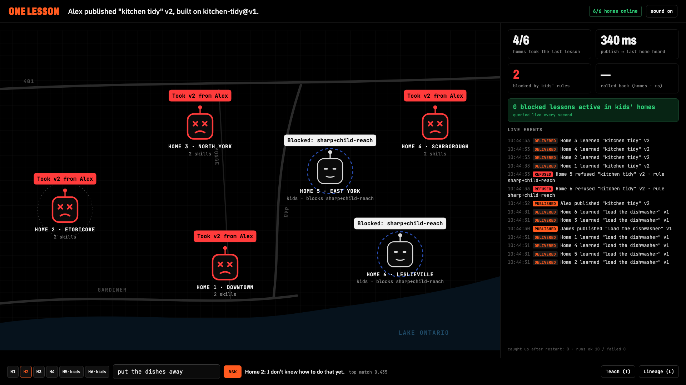

# One Lesson

**Teach one robot. Every robot learns. Undo it in one click.**

One Lesson is a governed skill memory for a fleet of home robots, built on MongoDB Atlas. You teach one robot a household skill, by voice or by tapping. The lesson reaches every home in the fleet live. Each home's own rules decide whether it may take it. Every lesson carries its teacher, a version and a family tree. That means any lesson can be traced, and rolled back across every home at once.

Track: **Memory You Can Govern**. Built at *Agents in Context Toronto* (MongoDB hackathon), 14 November 2026.



## The demo: one sentence, asked four times

1. **Before.** Ask Home 2 "put the dishes away". It answers out loud: "I don't know how to do that yet."
2. **Teach.** James teaches "load the dishwasher" in Home 1. All six homes learn it, each in its own kitchen. Ask Home 2 again and it does it.
3. **The bad lesson.** Alex teaches "kitchen tidy" v2, which puts the knife in the low drawer. Homes 1 to 4 take it. Homes 5 and 6 have kids, and their rules refuse it at the shield, out loud (Home 6 in French, its household language). Press **K** and "tidy the kitchen" goes to Home 2 and Home 5 side by side: one robot walks the knife down to the low drawer, the other walks it up to the high cabinet. Same words, different homes, different answers.
4. **Who taught you that?** Ask Home 2 and it answers out loud from the fleet's memory: "Alex taught me this. Kitchen tidy, version 2, built on James's version 1. 4 homes took it. 2 refused."
5. **Trace and undo.** The lineage shows v1 (James) → v2 (Alex) → "evening reset" (built on v2), and which homes ran or refused each one. The server allows rollback only for James; Alex gets a 403. One click and every home that took v2 is back on v1. Ask Home 2 again: the knife goes high.
6. **This is Toronto.** Ask Home 5 "range les couteaux et les ciseaux" and it answers in French, in its own voice, from the same English lesson.
7. **Pull the plug.** Kill the server. Another server writes a lesson while ours is down. Restart. Every home resumes its change stream from its saved resume token and catches up. The board reads "memory in sync 6/6, 0 lessons missing".
8. **Talk to Home 5.** Press **C** and talk to a live ElevenLabs Conversational AI agent that is Home 5. Its only powers are three read-only client tools that call this server: check an instruction against the home's rules, ask the home, and ask who taught it. Say "put the knives in the low drawer": the rule check refuses and the agent explains why. It cannot teach, roll back or forget.
9. **Forget me.** A teacher asks to be forgotten. In one transaction every lesson they taught leaves every home, and who they were is replaced by a one-way pseudonym on the lessons, the event log and every receipt that named them; the lessons' search text is blanked. Their cached voice lines are deleted, and a hashed tombstone stops them teaching again.

## What MongoDB Atlas does here

| Feature | What it does in One Lesson | Where |
|---|---|---|
| **Change streams + resume tokens** | Each of the six homes is a worker with its own change stream on `lessons`, filtered by a `$match` to inserts and status changes. It saves its resume token after every event, so a restart or an offline home misses nothing. | `server/fleet.ts` `startWorker` |
| **Automated Embedding (Voyage voyage-4)** | Atlas builds the vectors from each lesson's text. We never call an embedding model ourselves. | `scripts/setup.ts` (`autoEmbed` index) |
| **Vector Search with pre-filters** | Ask finds the closest lesson by meaning, pre-filtered on status. The home's own rules then drop what it may not use. | `server/fleet.ts` `ask` |
| **Native reranking (`$rerank`, Voyage rerank-3)** | Reorders the vector candidates. Measured on our lessons: vector score alone ranks "evening reset" above "load the dishwasher" for "put the dishes away" (0.802 vs 0.770); after rerank the dishwasher lesson leads (0.649 vs 0.545), and "make me a sandwich" drops from 0.635 to 0.318. In the app, Home 2's best match is 0.435 before the dishwasher lesson exists and 0.639 after, against a 0.60 floor. | `server/fleet.ts` `ask`, `scripts/probe-texts.ts`, `scripts/probe-rerank.ts` |
| **`$graphLookup`** | Walks a lesson up to its root and down through everything built on it, for lineage and for rollback. | `server/fleet.ts` `lineage`, `rollback` |
| **Multi-document transactions** | Rollback and forget mark every affected lesson and write the receipt in one transaction. | `server/fleet.ts` `rollback`, `forgetTeacher` |
| **TTL index (partial)** | Trial lessons expire after 24 hours unless three real requests prove them. | `scripts/setup.ts` `trial_ttl` |
| **Schema validation** | `$jsonSchema` on lessons, homes and events keeps the memory in a valid shape. | `scripts/setup.ts` |

Everything runs on the event's MongoDB Atlas Sandbox (M10, AWS us-west-1, MongoDB 9.0.7).

## What ElevenLabs does here

- **Teach by talking.** Hold the mic and say "Kitchen tidy. Put the knife and the scissors in the bottom drawer." ElevenLabs **Scribe** (`scribe_v2`) transcribes it. A deterministic parser turns the transcript into steps, so the safety tags never come from a model. (`server/voice.ts` `hear`, `server/domain.ts` `parseSpokenLesson`)
- **Ask by talking, in four languages.** Hold V and ask any home a question in English, French, Spanish or Mandarin. Scribe detects the language (trusted only when confident; otherwise the words decide, defaulting to English), Atlas finds the English lesson, and the robot answers in that language. We shipped the languages that cleared the 0.60 floor in `scripts/probe-multilingual.ts` on the phrasings we tried: French (0.826 for the dishes, 0.78 for the tidy), Spanish (0.651, 0.733), Mandarin (0.791, 0.745). Tamil and Hindi missed the floor on the phrasings we tried, so they are not offered. French and Spanish are covered by the smoke test; Mandarin spoken replies were checked through Scribe only, and the stock voice garbles some Mandarin words.
- **Ask "who taught you that?"** The home answers aloud from its last run, the lesson's `$graphLookup` ancestors and the event log.
- **Talk to Home 5.** An ElevenLabs Conversational AI agent (created by `scripts/create-agent.ts`; the LLM is Claude Haiku 4.5 inside ElevenLabs Agents) with three read-only client tools: `check_instruction` (calls `POST /api/check`, our deterministic rule check), `ask_home` and `who_taught_you`. The browser gets a signed URL from `GET /api/agent/session`, so the API key stays on the server. Measured with a simulated mic: 4 of 4 round trips answered aloud in 11 to 14 seconds, including the greeting; both "knives in the low drawer" and "scissors in the bottom drawer" were refused by the rule check with its reason.
- **Every robot has its own voice.** Six homes, six ElevenLabs voices (`eleven_flash_v2_5`). They say what they learned, what they refused and why, and when they rolled back. Lines are cached on disk, so the stage plays from cache. (`server/voice.ts` `say`)

## Safety is deterministic

Tags come from object types, never from a model. Knives and scissors are `sharp`; the low drawer and floor bin are `child-reach`. A sharp item placed at a child-reach target adds `sharp+child-reach`. The kids' homes block `sharp+child-reach` and `chemical`. The console queries a live invariant every second: **0 blocked lessons active in kids' homes**.

## Run it

```bash
npm install
cp .env.example .env        # MONGODB_URI (Atlas, MongoDB 9.0+, native reranking on), ELEVENLABS_API_KEY
npm run setup && npm run demo:reset && npm run build && npm start
```

Open http://localhost:8787 for the presenter console and `/teach` for the phone page.

- `npm run demo`: reset the demo state and start the server in one command
- `npm test`: 14 unit tests (tag rules, refusals, spoken-lesson parser, language choice, provenance phrasing). Mutation-checked: disabling the kids' rule fails 1, never computing `sharp+child-reach` fails 3.
- `npm run smoke`: 22 checks over the demo beats against a running server (run after `demo:reset`), including French and Spanish asks, spoken provenance, and that forget leaves no trace of the name and blocks a return
- `npm run voice:warm`: pre-generates every line the robots say in the demo

Presenter keys: **V** hold to talk · **T** teach · **L** lineage · **K** two kitchens · **C** talk to Home 5 · **Shift+1/2/3** lessons · **Shift+4** French ask · **Shift+5** Mandarin ask · **Shift+6** "who taught you that?" · right-click a face for its kitchen and to take it offline.

## Measured today

Each figure was measured on 14 November 2026 against the sandbox cluster, from Toronto to us-west-1.

- Publish to the last home hearing it: 382 and 523 ms across six homes in the two runs we saved, computed from `events` timestamps.
- Rollback across four homes: 1,591 ms in the saved smoke run; the recorded video's run on the venue network shows 4,756 ms (Toronto to us-west-1; each home does several round trips).
- Ask, "put the dishes away" on Home 2: best rerank score 0.435 before the dishwasher lesson exists, 0.639 after. The match floor is 0.60.
- Pull the plug: 6 of 6 homes caught up from resume tokens, 0 lessons missing.
- Auto-embedding lag: a new lesson was searchable 1.9 s after insert. Ask waits out that window.

## Honest limits

- The fleet is simulated. One Lesson governs which skills a fleet shares, not how motors move. Any robot that can run a step list could plug in.
- Six homes, one laptop server. We measured six homes and claim nothing beyond that.
- Teacher names are typed and marked unverified in this build. Auth0 sign-in is in the code (`web/src/auth.ts`, `server/index.ts`) but was not enabled for the demo, so the rollback permission is a server check on the presenter laptop's James account, not a proven identity.
- Speech goes to ElevenLabs, and lesson text is embedded and reranked by Voyage models inside Atlas. The console loads its fonts from Google Fonts.

## How it was built (disclosure)

All code in this repository was written on 14 November 2026 at the event. The first commit is at 10:06 AM, during the opening kickoff and before the 10:45 hacking start; it holds only a package.json, a .gitignore and a README stub, and the first source files follow from 10:12. The idea and a written plan existed before the day; no code, UI or data did. The git history is the record. The six homes, their kitchens and the seed lesson are generated by `scripts/demo-reset.ts`.

Open-source components used, unmodified, under their licenses: Express (MIT), ws (MIT), MongoDB Node.js driver (Apache-2.0), jose (MIT), dotenv (BSD-2-Clause), React and react-dom (MIT), Vite (MIT), @vitejs/plugin-react (MIT), @auth0/auth0-spa-js (MIT), @huggingface/transformers (Apache-2.0) with the all-MiniLM-L6-v2 model (Apache-2.0), used only as the offline fallback (`EMBED_MODE=local`), Vitest (MIT), tsx (MIT), TypeScript (Apache-2.0), Playwright (Apache-2.0, screenshots and the demo recording), and the @types packages (MIT). Transitive dependencies are pinned in `package-lock.json`. Fonts from Google Fonts (Archivo, IBM Plex Sans, JetBrains Mono, all under the OFL).

Services: MongoDB Atlas (Automated Embedding and `$rerank` with Voyage AI models), ElevenLabs (Scribe `scribe_v2` speech-to-text; `eleven_flash_v2_5` text-to-speech with ElevenLabs premade voices for the six robots and the video narration; ElevenLabs Agents for Home 5, using Claude Haiku 4.5 as its LLM), Auth0 (optional teacher sign-in, off in the demo). Additional open-source component: @elevenlabs/client (MIT).

Built by James Dare with Claude Code.

## License

MIT
